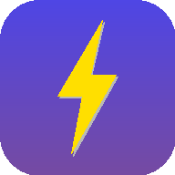

<div align="center">



# ⚡ 9M2PJU Generator Load Calculator

### Size any generator in seconds — running kW, peak kVA, cable check, voltage drop & fuel runtime.


**🌐 Live demo → https://generator.hamradio.my**

</div>

---

## ✨ Why you'll love it

| | |
|---|---|
| 🧮 | **Live sizing engine** — running kW/kVA, peak demand with starting surge, loading gauge. No Calculate button needed. |
| 🔌 | **Smart loads** — presets for lighting, sockets, office, fridge, air-cond, pump & motor. Quantity steppers, surge factors, one-tap duplicate. |
| 🔎 | **Cable & supply check** — copper/alu, 1-ph 230 V / 3-ph 400 V, length-based voltage drop, ampacity utilisation warnings. |
| ⛽ | **Fuel runtime** — manual burn rate or auto-estimate per fuel type (diesel / petrol / gas / inverter). |
| 📲 | **Installable PWA** — add to home screen, full-screen, works fully offline. |
| 🌙 | **Dark mode** — automatic + manual toggle. |
| 💾 | **Zero setup** — autosaves to your browser, copy / share / print the summary. |

## 🚀 Quick start

```bash
git clone https://github.com/9M2PJU/9M2PJU-Generator-Load-Calculator.git
cd 9M2PJU-Generator-Load-Calculator
python3 -m http.server 8000
# → open http://localhost:8000/
```

> 💡 Service workers need `http(s)` — use localhost, not `file://`.

## 📲 Install as an app

| Platform | How |
|---|---|
| 🖥️ Desktop (Chrome / Edge) | Click the install icon in the address bar, or **⬇ Install App** in the header |
| 🤖 Android | Browser menu → **Install** / Add to Home Screen |
| 🍎 iOS Safari | Share → **Add to Home Screen** |

Offline support is powered by `sw.js` (cache-first app shell).

## 🧮 How the math works

| Quantity | Formula |
|:---|:---|
| Apparent power | `S (kVA) = P (kW) ÷ PF` — for running *and* peak |
| Loading | `load % = S_load ÷ S_gen × 100` (peak for sizing, running for fuel) |
| Current · 1-ph | `I = P ÷ (V × PF)`, `V = 230 V` |
| Current · 3-ph | `I = P ÷ (√3 × V_LL × PF)`, `V_LL = 400 V` |
| Volt drop · 1-ph | `Vd = 2 × I × ρ × L ÷ A` |
| Volt drop · 3-ph | `Vd = √3 × I × ρ × L ÷ A` · ρ Cu 0.0172, Al 0.0282 Ω·mm²/m |
| Fuel @100 % (auto) | `burn = kVA × PF × L/kWh` · diesel 0.25 · petrol 0.35 · gas 0.30 · inverter 0.23 |
| Fuel @running | `burn × load fraction` (linear with load) |
| Runtime | `hours = fuel (L) ÷ burn@running (L/h)` |

✅ **Verified by hand:** 5 kW run / 8 kW peak on 10 kVA @ PF 0.8 →
6.25 kVA run · 10.0 kVA peak (100 %) · 27.17 A (1-ph) / 9.02 A (3-ph) ·
4.67 V (2.03 %) drop on 20 m 4 mm² Cu · 2.00 L/h @100 % → **32 h on 40 L**.

<details>
<summary>⚠️ Simplifications & assumptions (click to expand)</summary>

- Ampacity is rule-of-thumb for a typical single run — ambient, grouping, conduit and installation-method derating are **not** modelled.
- Voltage drop is resistive-only; reactance and temperature effects ignored.
- Peak kVA uses running PF; motor *starting* PF is lower, so true starting kVA can be higher.
- Fuel burn scales linearly; real sets burn ~20–30 % even lightly loaded, so light-load runtime is optimistic.
- Always verify against local wiring codes (e.g. Suruhanjaya Tenaga / IEC 60364) and the generator datasheet.

</details>

## 🗂️ Project structure

```text
├── index.html              App shell & UI
├── styles.css              Design system (light/dark, responsive)
├── app.js                  Calculator logic, PWA install, persistence
├── manifest.webmanifest    PWA manifest
├── sw.js                   Offline service worker
├── icons/                  App icons (192/512, maskable, favicon)
└── CNAME                   Custom domain (GitHub Pages)
```

## 💖 Support the project

If this calculator saved you a site visit, consider buying the maintainer a coffee —
it keeps the repeater lights on. Every ringgit counts. Thank you! 🙏

<div align="center">

<a href="https://paypal.me/9M2PJU">
  
</a>
&nbsp;
<a href="https://buymeacoffee.com/9m2pju" target="_blank">
  
</a>

<br/>

<sub>Prefer a direct link? <a href="https://paypal.me/9M2PJU">paypal.me/9M2PJU</a> · <a href="https://buymeacoffee.com/9m2pju">buymeacoffee.com/9m2pju</a></sub>

</div>

---

<div align="center">

Made for 🇲🇾 by <b><a href="https://hamradio.my">9M2PJU</a></b> · 73! 📻

</div>
